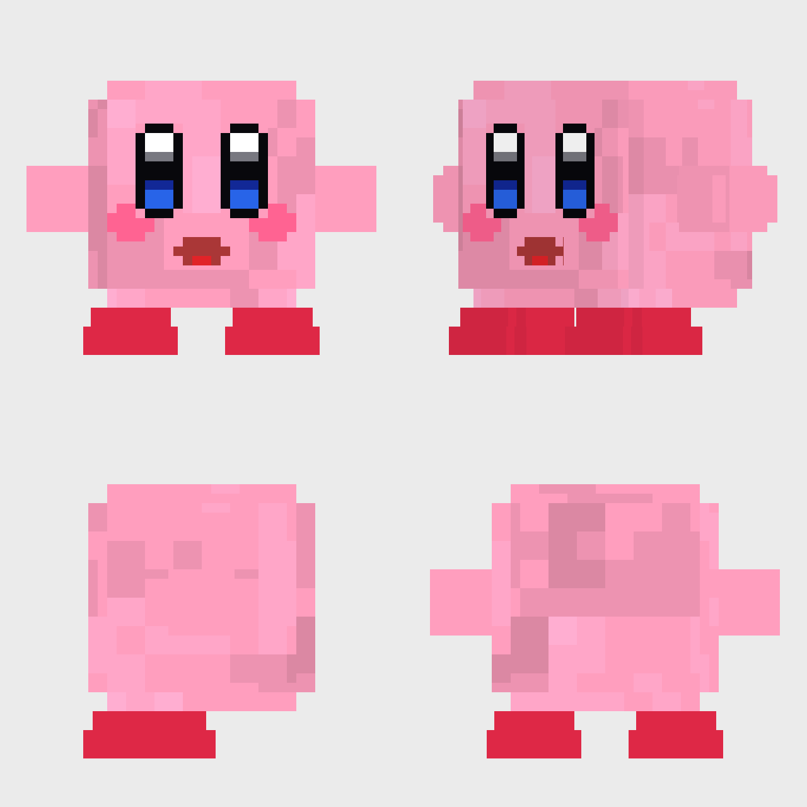

# Cobblemon Kirby

A standalone **Cobblemon 1.8.1** addon (Fabric, Minecraft 1.21.1, Java 21) that adds **Kirby** as a real
Cobblemon species with a custom 3D model, a full animation set and a signature ability, **Copy Ability**.



*(preview rendered by `tools/preview.py`, a small software renderer used because Blockbench/Minecraft are not
available in the build environment; in-game lighting and proportions will differ slightly.)*

| | |
|---|---|
| Species id | `cobblemon_kirby:kirby` |
| Pokédex number | **1984** (Cobblemon tracks dex numbers per namespace, so this cannot collide with `cobblemon:` species) |
| Type | Fairy (no secondary type) |
| Base stats | **HP 115 / Atk 65 / Def 99 / SpA 65 / SpD 115 / Spe 111** – copied programmatically from Cobblemon's own Scream Tail file (`tools/gen_species.py`) and enforced by a unit test |
| Ability | Copy Ability (both the normal and hidden slot) |
| Learnset | Scream Tail's learnset (valid Cobblemon moves; replace `moves` in `species/kirby.json` to taste) |

## Requirements

| Component | Version |
|---|---|
| Minecraft | 1.21.1 |
| Fabric Loader | ≥ 0.17.2 (built against 0.19.3) |
| Fabric API | ≥ 0.116.6+1.21.1 |
| Cobblemon | ≥ 1.8.0 (built and verified against **1.8.1**) |
| Java | 21 |

No additional dependencies: Kotlin support is already bundled inside Cobblemon.

## Installation

The **same jar goes on the server *and* on every client** (it carries data *and* assets):

* **Server** – data: species, ability script, dex entry, spawn; plus the Java verification / `/kirbycopy` command.
* **Client** – assets: the model, texture, animations, poser and translations. A client without the jar sees a
  missing-model placeholder (and untranslated names) for Kirby.

1. Install Fabric Loader, Fabric API and Cobblemon 1.8.x.
2. Drop `cobblemon-kirby-1.0.0.jar` into `mods/` on the server and on every client.
3. Start. On server start the log contains either
   `Kirby (#1984) verified: stats match Scream Tail, Fairy type, Copy Ability registered.` or one
   `Kirby verification failed: …` line per problem.

Singleplayer: just put it in your `mods/` folder.

## Using Kirby

```
/givepokemon <player> cobblemon_kirby:kirby level=20     (operator)
/spawnpokemon cobblemon_kirby:kirby                      (operator)
/kirbycopy machamp                                       (anyone: shows what Copy Ability would copy)
```

Kirby also spawns in nature: ultra-rare, grounded, on floral biomes (`#cobblemon:is_floral`), level 10–35
(`data/cobblemon_kirby/spawn_pool_world/kirby.json`). It is added to the National Pokédex.

## Copy Ability

> Kirby copies the highest **base** stat of the opposing Pokémon it is facing.

Implementation: Cobblemon runs all battles in an embedded Showdown simulator and loads ability scripts from
`data/<namespace>/abilities/*.js` in any datapack. Copy Ability is therefore a normal ability script –
[`copyability.js`](src/main/resources/data/cobblemon_kirby/abilities/copyability.js) – **no mixins, no reflection,
no patches to Cobblemon**.

How it works:

1. **Entering battle / foe changes.** `onStart` and `onUpdate` look up the facing foe's current species and read
   `foe.species.baseStats` (the species table – never the foe's final stats, stages, items or statuses).
2. **Choosing the stat.** The highest of Atk/Def/SpA/SpD/Spe is selected *dynamically* from those numbers – there is
   no species list anywhere.
3. **Applying it.** The foe's base value replaces Kirby's base value for **that one stat** in Showdown's normal stat
   formula together with Kirby's own level, IVs, EVs and nature (`battle.spreadModify`), and only that entry of
   `storedStats` is written. The five other stats keep Kirby's own Scream-Tail-derived values. Species data is never
   written to.
4. **Idempotent.** The last `foeSpecies:stat` is remembered in the Pokémon's own `abilityState`; nothing is recomputed
   or announced again until the foe's species or the chosen stat changes. No stacking, no loops.
5. **Cleanup.** `onSwitchOut` and `onEnd` (ability removed/suppressed, e.g. Gastro Acid) restore the stat; Showdown
   additionally rebuilds every stat from species data on each switch. State lives on the individual Pokémon, so
   several Kirbys (also in multiplayer / multi battles) never share it.
6. **Announcement.** `-activate` message → *"Kirby copied Machamp's base Attack!"* (`cobblemon.battle.activate.copyability`).

### Rules that were not fully specified, and what was chosen

| Case | Behaviour |
|---|---|
| **Tie for highest** | First stat in the fixed order **Attack > Defense > Sp. Atk > Sp. Def > Speed** wins. |
| **Which foe** (doubles/triples) | The foe in the mirrored slot (the one "facing" Kirby); if that slot is empty/fainted, the first active foe. |
| **Foe is Mega/other forme, Transform** | The foe's *current* species (`foe.species`) is used, so a forme change re-targets the copy. |
| **Illusion** | The real species is used (not the disguise). |
| **Kirby is transformed** | No copying while `transformed`. |
| **Skill Swap / Role Play / Entrainment / Trace** | Blocked via ability flags – Copy Ability stays Kirby's. |
| **Switch / faint / battle end** | Restored on switch-out and ability end; fainted/benched Kirby holds baseline stats (tested). |

### Known limitation: HP is not copyable

The task asks to compare all six base stats. Five are copied exactly as described. **HP cannot be**, because of how
Cobblemon consumes Showdown output: for every `-damage`/`-heal` line it writes Showdown's *absolute* HP number
straight into the persistent Pokémon (`DamageInstruction`: `currentHealth = remainingHealth`). Changing Kirby's max
HP inside Showdown would therefore corrupt Kirby's saved HP after the battle (or exceed its real maximum).
Fixing that would require invasive patches to Cobblemon's battle interpreter, which the task rules out, and a
stat-stage boost would be a different mechanic.

Closest valid behaviour implemented: **HP is never a candidate; if HP is the opponent's highest stat, the best of
the other five is copied** (e.g. against Blissey, Kirby copies Special Defense 135). Because of that, the rule is
simply "highest of the five copyable stats". The `/kirbycopy` command prints a note when HP was higher.

## Build

```
# Windows
set JAVA_HOME=C:\Program Files\Java\jdk-21
gradlew.bat build

# Linux / macOS
JAVA_HOME=/path/to/jdk-21 ./gradlew build
```

Output: **`build/libs/cobblemon-kirby-1.0.0.jar`** (plus `-sources.jar`). A prebuilt copy is in `dist/`.
First build downloads Minecraft, mappings and Cobblemon (via the Modrinth Maven proxy, version id `gBW3vLC7`).
The Gradle wrapper pins Gradle 9.5.1; JDK 21 is required to run it.

## Tests

```
./gradlew test                       # 17 JUnit tests
python tools/run_battle_tests.py     # 20 battle tests in Cobblemon's own Showdown simulator (needs Node 18+)
```

* `CopyAbilityRuleTest` – selection rule, tie-breaks (reference implementation of the JS).
* `KirbySpeciesJsonTest` – dex 1984, Fairy only, stats equal to Scream Tail's file inside the Cobblemon jar, learnset, ability slots, script has no `//` comments.
* `AssetIntegrityTest` – every Molang expression parsed with **Cobblemon's own Molang parser**; animated bones
  exist; every animation the poser references exists; UV footprints inside the texture; resolver/texture/lang present;
  polygon budget.
* `tests/copyability.test.js` – the real ability script and species data run through the real
  `BattleStream` that ships inside the Cobblemon jar (singles and doubles): correct stat per foe, ties, HP untouched,
  nature/IV/level honoured, foe switch, Kirby switch-out/in, faint, replacement foe, Gastro Acid, two Kirbys,
  announcement exactly once, no engine errors, species data unchanged.

## What was and was not verified

| Verified (automated) | Not verified – needs an in-game check |
|---|---|
| Project compiles, jar builds, 17 JUnit tests pass | Mod loads under Fabric on a live 1.21.1 server/client (needs Minecraft EULA acceptance for `runServer`; not done on your behalf) |
| Ability logic against Cobblemon's real Showdown (20 scenarios) | `Kirby ... verified` log line / `/kirbycopy` / spawn / dex entry |
| All Molang parses with Cobblemon's parser, bones/animations/UVs/files consistent | Rendering: model orientation, how animations *look*, portrait/profile framing (`portraitScale`, `profileScale`) |
| Species data equals Scream Tail's stats | Chat rendering of the activation message in Cobblemon's battle UI |

Things most likely to need a small tweak after the first in-game look: `portraitScale` / `profileScale` /
translations in `posers/kirby/kirby.json`, `baseScale` / `hitbox` in `species/kirby.json`, and animation amplitudes.
The body is a notched cube, so the silhouette is blocky by design; the model uses no rotated cubes.

## Project layout

```
src/main/java/com/alexcoronel/cobblemonkirby/
  CobblemonKirby.java            entrypoint (command + post-load verification)
  KirbyConstants.java            ids / dex number
  ability/CopyAbilityRule.java   reference selection rule (mirrors the script, unit-tested)
  species/KirbySpeciesVerifier   read-only integrity check against the live registries
  command/KirbyCopyCommand       /kirbycopy <species>
src/main/resources/
  fabric.mod.json
  data/cobblemon_kirby/
    abilities/copyability.js     Copy Ability (Showdown script)
    species/kirby.json           species (dex 1984, Scream Tail stats, Fairy)
    dex_entries, dexes, dex_additions, spawn_pool_world
  assets/cobblemon_kirby/
    bedrock/pokemon/models/kirby/kirby.geo.json            Blockbench-compatible Bedrock geometry
    bedrock/pokemon/animations/kirby/kirby.animation.json  animations
    bedrock/pokemon/posers/kirby/kirby.json                pose -> animation wiring
    bedrock/pokemon/resolvers/kirby/0_kirby_base.json      species -> poser/model/texture (+ shiny)
    textures/pokemon/kirby/kirby.png, kirby_shiny.png      128x192
    lang/en_us.json
tools/   gen_species.py  gen_assets.py  preview.py  run_battle_tests.py
tests/   copyability.test.js
```

### Model and animations

* 18 cubes / 108 quads. **Body = a 24 × 24 × 24 cube** with its 12 edges notched 2 units (three overlapping boxes) so
  it is less blocky, wearing a fluffy pink texture generated procedurally (`body_region` in `tools/gen_assets.py`).
  Kirby-specific parts: tiered red feet, tall glossy blue eyes and an open red mouth set flush into the face, blush
  cheeks painted on the face, and large stubby arms. Separate `eye_left` / `eye_right` / `mouth` bones keep blinking
  and expressions working, and the locators Cobblemon's effects expect are kept (`root`, `middle`, `top`, `target`,
  `special`, `face`, `head`, `hand_primary`, `physical`, `item`, `foot_primary`, …). `baseScale` is 0.7 (hitbox
  1.6 × 1.9 at scale 1); the model is authored at 2× so the face has pixels to work with. Textures are 128×192.
* Animations (all in `kirby.animation.json`): `ground_idle` (breathing), `ground_walk` (waddle bounce, 0.8 s),
  `ground_run` (0.5 s, leaning), `battle_idle` (alert crouch), `physical` (lunge + punch), `special` (inhale/puff),
  `air_idle` / `air_fly` (flight: Kirby inflates 1.4× like a balloon, arms flap, feet dangle; `HOVER`/`FLY` poses, species has `canFly`), `status` (hop), `recoil` / `battle_recoil` (damaged), `faint` (flops flat, holds the pose), `sleep`, `cry` /
  `battle_cry`, `blink` quirk. Loops are Molang-driven (`math.sin(q.anim_time*…)`) so they are seamless.
* Open `kirby.geo.json` + `kirby.png` in Blockbench (*Open Model*, Bedrock) to hand-edit. To regenerate from code:
  `python tools/gen_assets.py` (needs Pillow).

## Licence / credits

* **Everything in this repository** (code, Showdown script, species/dex/spawn data, model, textures, animations) is
  original work under the [MIT licence](LICENSE). No third-party art is included (see [NOTICE.md](NOTICE.md)).
* *Kirby* is a character owned by Nintendo / HAL Laboratory; this is an unofficial fan addon.
* Cobblemon is MPL-2.0 and is not redistributed here.
